# Ruinas de Zaculeu - Raytracing en Rust

Este proyecto es un diorama inspirado en las **ruinas de Zaculeu, Huehuetenango, Guatemala**. La escena está construida con cubos texturizados e incluye una plaza, una fuente, gradas, muros, vegetación, antorchas y un altar.

Todo el render se calcula en CPU. El proyecto no usa la tarjeta de video ni librerías externas de Rust.

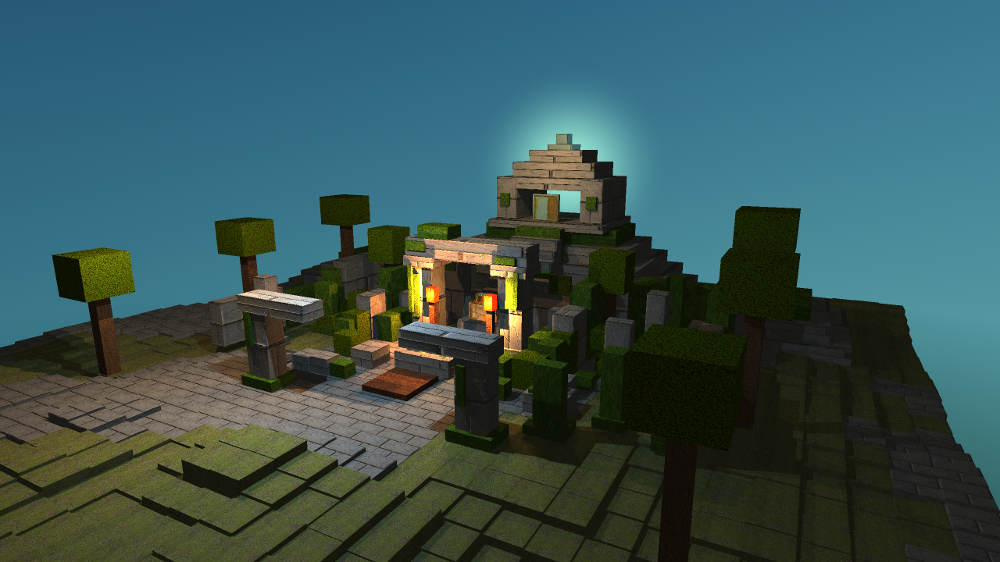

## Video

[Video del diorama](https://github.com/user-attachments/assets/10ae397c-23c2-4e50-aeeb-6d77b6578c1a
)

## Requisitos cumplidos

| Requisito | Cómo se muestra en el proyecto |
|---|---|
| Escena compleja | La escena tiene 1.188 bloques entre terreno, gradas, muros, fuente, altar, árboles y restos de construcciones. |
| Presentación visual | La vista principal usa el altar y la fuente como centro, con vegetación y luces cálidas alrededor. |
| Paralelismo y optimización | El render se reparte entre varios hilos del CPU y usa una BVH para evitar revisar todos los bloques en cada rayo. |
| Rotación y zoom | La cámara puede rotar, acercarse y alejarse. El video demuestra ambos movimientos. |
| Cinco materiales | Piedra, musgo, madera, oro y agua tienen texturas y propiedades diferentes. |
| Refracción | El agua de la fuente permite ver y distorsiona los bloques que están debajo. |
| Reflexión | El altar de oro refleja los colores y objetos cercanos. |
| Mapas normales | La piedra muestra relieve en las juntas y grietas sin agregar más cubos. |
| Material emisivo | Las antorchas brillan e iluminan la piedra y el altar. |
| Skybox | El cielo aparece alrededor de las ruinas y también en los reflejos. |
| Terreno procedural | El terreno genera 32×32 cubos a partir de una semilla fija. |

## Cómo ejecutar el proyecto

Se necesita Rust 1.85 o una versión posterior.

```bash
git clone https://github.com/josesan28/raytracing-proyecto.git
cd raytracing-proyecto
cargo run --release
```

La ventana abre en el modo adaptativo. Para generar una imagen final:

```bash
cargo run --release -- --render
```

## Controles

| Control | Acción |
|---|---|
| Arrastrar con el botón izquierdo | Rotar la cámara. |
| Rueda del ratón | Acercar o alejar. |
| A / D o flechas izquierda / derecha | Rotar horizontalmente. |
| W / S o flechas arriba / abajo | Rotar verticalmente. |
| + / − | Acercar o alejar. |
| R | Restablecer la cámara. |
| P | Guardar una imagen con calidad máxima. |
| Esc | Cerrar la ventana. |

## Modos de calidad

| Tecla | Modo | Descripción |
|---|---|---|
| F1 | Adaptativo | Reduce temporalmente el costo mientras se mueve la cámara y recupera la calidad completa al detenerse. |
| F2 | Calidad constante | Mantiene la calidad máxima durante el movimiento. |
| F3 | Económico | Permite desactivar los efectos que más tiempo consumen. |

En el modo económico se pueden cambiar estas opciones:

| Tecla | Opción |
|---|---|
| F4 | Sombras |
| F5 | Reflexión |
| F6 | Refracción |
| F7 | Mapas normales |
| F8 | Antialiasing |

## Escena

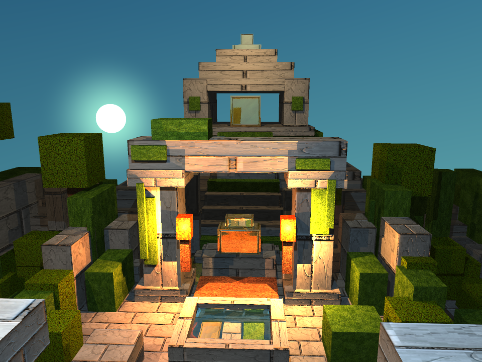

La escena toma como referencia las **ruinas de Zaculeu**. Está formada por una plaza central, plataformas escalonadas, muros incompletos y bloques dispersos. La vegetación rodea las construcciones y ayuda a mostrar que son ruinas antiguas.

La fuente se colocó frente al altar para que el agua sea visible. Las antorchas iluminan la zona central y hacen más fácil distinguir la reflexión del oro y el relieve de la piedra.

## Materiales y texturas

Los cinco materiales principales tienen una textura y valores propios. El albedo se muestra como una combinación de rojo, verde y azul.

| Material | Textura | Albedo | Especular | Transparencia | Reflectividad | Uso en la escena |
|---|---|---:|---:|---:|---:|---|
| Piedra | 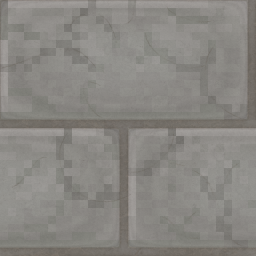 | (0,92; 0,94; 0,90) | 0,15 | 0 | 0 | Muros, gradas, columnas y fuente. |
| Musgo | 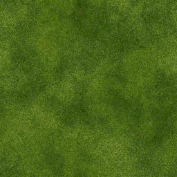 | (0,82; 0,94; 0,78) | 0,04 | 0 | 0 | Bloques húmedos y vegetación sobre las ruinas. |
| Madera | 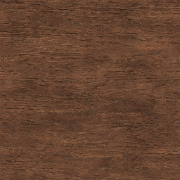 | (0,92; 0,82; 0,68) | 0,18 | 0 | 0 | Plataformas y soportes de las antorchas. |
| Oro | 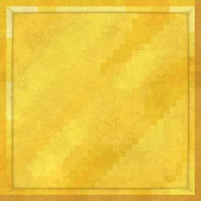 | (1,00; 0,90; 0,55) | 0,85 | 0 | 0,65 | Altar, adornos y bloques bajo el agua. |
| Agua |  | (0,58; 0,86; 0,92) | 0,90 | 0,78 | 0,12 | Fuente transparente con refracción. |

Otros materiales visibles:

| Material | Textura | Uso en la escena |
|---|---|---|
| Suelo | 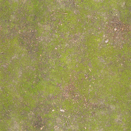 | Terreno alrededor de las ruinas. |
| Corteza | 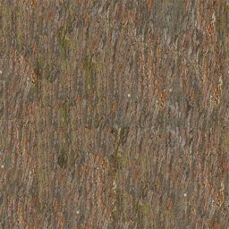 | Troncos de los árboles. |
| Hojas | 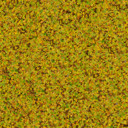 | Copas y vegetación. |
| Llama | 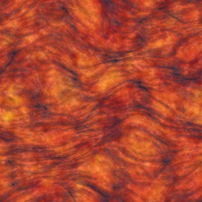 | Antorchas emisivas. |

El programa carga los archivos PPM que se encuentran en `assets/textures/`.

### Créditos de las texturas

Las texturas base utilizadas y adaptadas para este proyecto provienen de:

- [Faithful Resource Pack](https://faithfulpack.net/): texturas con estilo de bloques usadas como base para piedra y oro.
- [ambientCG](https://ambientcg.com/): texturas usadas como base para musgo, madera, suelo, corteza, hojas y llama.

Las imágenes fueron ajustadas y convertidas a PPM para que el raytracer pudiera cargarlas sin librerías externas. El agua, el cielo y otros recursos sencillos se prepararon para esta escena.

## Efectos visibles

### Refracción del agua

| Activada | Desactivada |
|---|---|
| 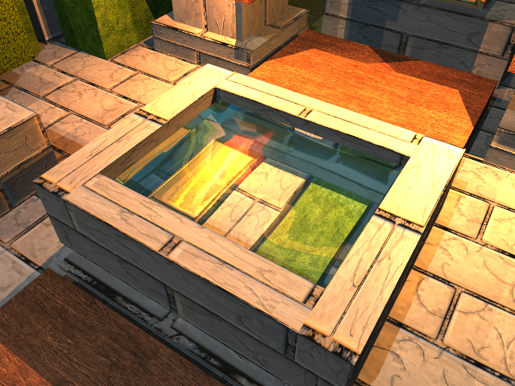 | 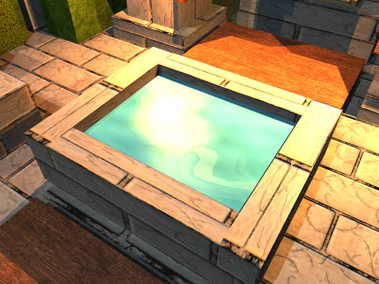 |

Con la refracción activada se ven los bloques colocados debajo del agua. El agua usa un índice de refracción de 1,33.

### Reflexión del oro

| Activada | Desactivada |
|---|---|
| 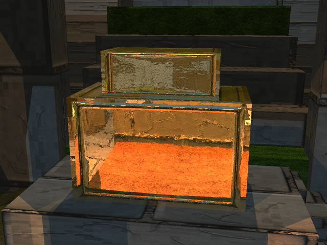 | 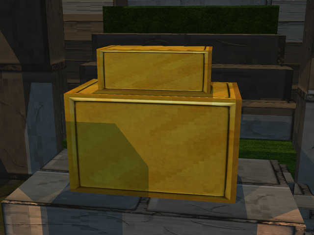 |

El altar refleja parte de la escena y la luz de las antorchas.

### Relieve de la piedra

| Mapa normal activado | Mapa normal desactivado |
|---|---|
| 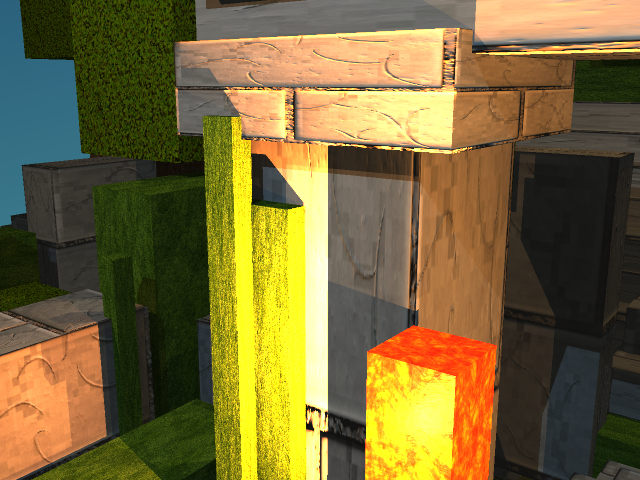 | 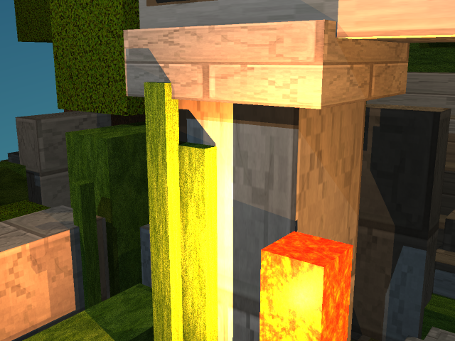 |

El mapa normal marca las grietas y separaciones de la piedra cuando recibe luz.

### Antorchas

| Emisión activada | Emisión desactivada |
|---|---|
| 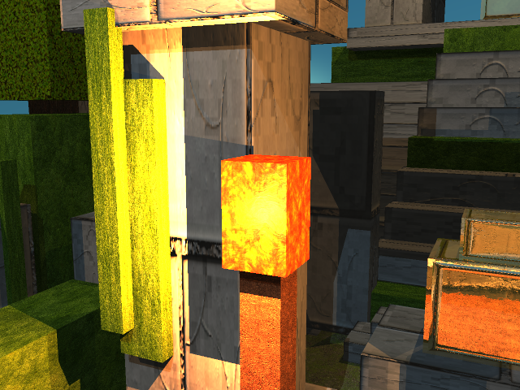 | 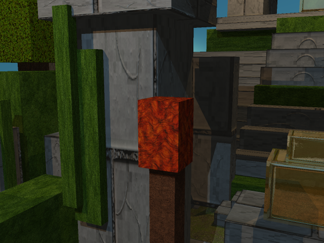 |

Las llamas tienen un material emisivo y dos luces cercanas que iluminan el centro de la escena.

### Skybox

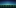

El cielo se ve en los espacios abiertos, en el agua y en los reflejos del oro.

## Terreno procedural

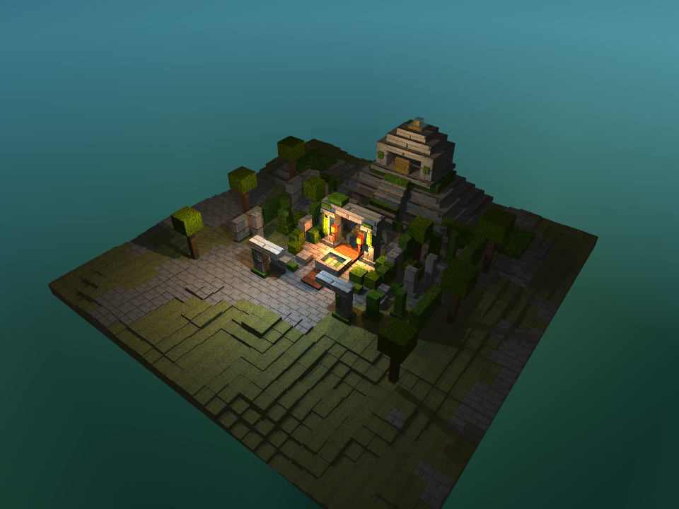

El terreno genera una zona de **32×32 cubos**. Usa la semilla 40, por lo que siempre produce el mismo resultado. La parte central se mantiene más plana para que las construcciones sean fáciles de reconocer.
